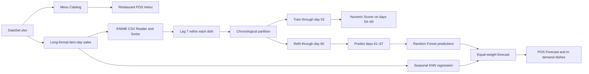

# Restaurant sales forecasting

The Information Systems project brief, `IS_Finals.pdf`, informed the POS dashboard and KNIME workflow. `DataSet.xlsx` supplies the dish catalog and 60 observed days of units sold. The hybrid system combines KNIME Random Forest regression and seasonal k-nearest-neighbors (KNN) regression to forecast demand for workbook days 61–67.

## Architecture



## Run the workflow

1. Install the Python dependency with `python -m pip install openpyxl`. Run the export from the repository root with the path to your workbook.

   ```powershell
   python forecasting/prepare_dataset.py "C:/path/to/DataSet.xlsx"
   ```

2. In KNIME Analytics Platform 5.12, import the [Restaurant Forecast workflow folder](Restaurant%20Forecast). Copy `forecast-input.csv` and `sales-history.csv` into the imported workflow's `data` folder if KNIME created a copy. Use **Open Workflow Folder** in KNIME to find it. The reader and writers use paths relative to that folder.
3. Reset any previous execution, then **Execute All**. KNIME writes the future predictions to `forecast.csv` and holdout predictions to `validation-predictions.csv`. It also writes category totals and both Numeric Scorer CSVs for the Random Forest and previous-week baseline.
4. Run the hybrid stage with Node.js. Supply `--data` if KNIME used an imported copy. Add `--bundle` only when replacing the project's bundled forecast and validation results.

   ```powershell
   node forecasting/build_snapshot.mjs
   node forecasting/build_snapshot.mjs --data "C:/path/to/imported/workflow/data"
   ```

5. Open **Forecast → Import forecast CSV** in the POS and select `hybrid-forecast.csv`. The dashboard checks the dish-day coverage and that each forecast is the mean of both model predictions. Turn on **Show only in-demand dishes** to view the predicted leaders by category. **Use workbook forecast** restores the bundled hybrid after an import.

The included workflow source is saved without run data. Git ignores the raw workbook exports, KNIME outputs and trained model caches. The app bundles dish metadata, projected units and aggregate validation metrics.

To package the committed workflow as an importable archive, run this from the repository root.

```powershell
git archive --format=zip --prefix="Restaurant Forecast/" -o "forecasting/Restaurant Forecast.knwf" "HEAD:forecasting/Restaurant Forecast"
```

## KNIME workflow

| Stage | Node and configuration |
| --- | --- |
| Read and sort | CSV Reader reads `forecast-input.csv`. Sorter orders by `Item_ID`, then numeric `Day`. |
| Build the lookback | Group Loop Start groups by `Item_ID`. Lag Column creates `Units_Sold(-7)`, using the same dish's units seven days earlier. Missing Value removes rows with a missing lag (days 1–7). Loop End joins the dishes back into one table. |
| Partition by time | Rule Engine assigns rows to Training (days 8–53), Validation (54–60) or Forecast (61–67). Two Rule-based Row Splitters route the partitions. Every validation lag comes from days 47–53, before the holdout. |
| Fit and score | Random Forest Learner (Regression) fits 200 bootstrap-sampled trees with seed 20261121. Predictors are dish ID, category, unit price, weekday and lagged units. Random Forest Predictor scores the validation rows. Two Numeric Scorer nodes compare the model and the previous-week baseline against actual units. |
| Forecast and export | A second learner refits on observed days 8–60, then predicts days 61–67 using known lags from days 54–60. GroupBy sums Random Forest estimates by category and day. CSV Writers export the individual, grouped and validation results. |

The workbook's daily rows provide the observations. The forest excludes same-day revenue and the partition label from its predictors and uses same-day units only as its target.

## Hybrid demand prediction

For each dish and target day, [seasonal KNN](seasonal_knn.mjs) searches previously observed sales for the same dish and weekday. It picks the three examples with the closest seven-day lag and breaks distance ties by recency. The examples receive weights of `1 / (1 + distance)`. The hybrid averages the Random Forest and weighted KNN predictions equally.

The POS sums projected servings across the selected day or week, then ranks dishes in each category. It flags the highest quarter, rounded up, including positive ties at the cutoff. The dish search preserves that ranking. Gross sales estimates use workbook menu prices.

## Holdout results

Both models used observations through day 53 to forecast days 54–60. The holdout includes 420 dish-day observations. After scoring, both methods use observations through day 60 to forecast days 61–67.

| Method | Mean absolute error (servings) | Root mean squared error (servings) |
| --- | ---: | ---: |
| Hybrid | 1.519 | 2.168 |
| KNIME Random Forest | 1.696 | 2.587 |
| Seasonal KNN | 1.572 | 2.153 |
| Same dish seven days earlier | 1.433 | 2.013 |

Of the 119 dish-days flagged by the hybrid on the holdout, 109 were among the actual category leaders on their forecast day (91.6% precision). The previous-week baseline had the lowest unit error on this workbook. New POS checkout records stay in the POS sales history. The forecasts use the supplied workbook history.

## Data dictionary

| Field | Type | Meaning |
| --- | --- | --- |
| `Item_ID` | Text | Stable workbook dish identifier used by the POS catalog and forecast. |
| `Category` | Text | Appetizer, Entree, Drinks, Dessert or Sides. |
| `Dish_Name` | Text | Display name in the source catalog. |
| `Main_Ingredient` | Text | Workbook ingredient label used as a menu description. |
| `Unit_Price` | Decimal (PHP) | Workbook menu price per serving. |
| `Day` | Integer | Workbook sequence number starting at 1. |
| `Day_of_Week` | Text | Mon through Sun with day 1 as Mon. |
| `Units_Sold` | Integer or blank | Observed servings for that dish and day. Blank for upcoming rows. |
| `Total_Revenue` | Decimal (PHP) or blank | Observed units times menu price. Blank for upcoming rows. |
| `Units_Sold(-7)` | Integer | Observed units for this dish exactly seven workbook days earlier. |
| `Partition` | Text | Training, Validation or Forecast. |
| `Predicted_Units` | Decimal | Mean prediction across the trees in the KNIME CSV. The hybrid CSV uses this field for the equal-weight combination. |
| `Random_Forest_Units` | Decimal | Random Forest prediction copied into the hybrid CSV. |
| `KNN_Units` | Decimal | Weighted estimate from the nearest historical neighbors. |
| `Predicted_Units (Prediction Variance)` | Decimal | Variance across individual tree predictions. |
| `Sum(Predicted_Units)` | Decimal | Projected total servings for a category and day. |
