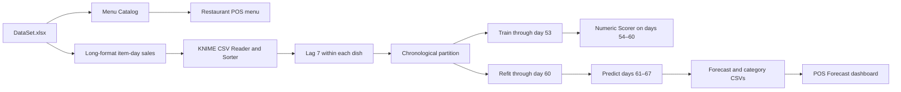

# Restaurant sales forecasting

The Information Systems project brief, `IS_Finals.pdf`, informed the POS dashboard, the KNIME workflow and the documentation below. `DataSet.xlsx` supplies the dish catalog and 60 observed days of units sold. The observations use numbered workbook days. The forecast covers the next seven numbered days, 61–67.

## Architecture



## Run the workflow

1. Install the Python dependency with `python -m pip install openpyxl`. Run the export from the repository root with the path to your workbook.

   ```powershell
   python forecasting/prepare_dataset.py "C:/path/to/DataSet.xlsx"
   ```

2. In KNIME Analytics Platform 5.12, import the [Restaurant Forecast workflow folder](Restaurant%20Forecast). If using a `.knwf` archive, copy `forecast-input.csv` into the imported workflow's `data` folder. Use **Open Workflow Folder** in KNIME to find it. The CSV Reader and writers use paths relative to that folder.
3. Reset any previous execution, then **Execute All**. The CSV Writers place `forecast.csv`, `category-forecast.csv`, `numeric-scorer.csv` and `baseline-scorer.csv` in the workflow's `data` folder.
4. In the POS, open **Forecast → Import KNIME CSV** and select `forecast.csv`. The app validates a complete set of workbook dish IDs and days before saving it locally. To update the built-in preview used by fresh installs, copy the three result CSVs into the repository workflow's `data` folder and run `node forecasting/build_snapshot.mjs`.

The included workflow source is saved without run data. Git ignores the raw workbook exports, KNIME outputs and trained model caches. The app bundles dish metadata, projected units and aggregate validation metrics.

To package the committed workflow as an importable archive, run this from the repository root.

```powershell
git archive --format=zip --prefix="Restaurant Forecast/" -o "forecasting/Restaurant Forecast.knwf" "HEAD:forecasting/Restaurant Forecast"
```

## KNIME workflow

| Stage | Node and configuration |
| --- | --- |
| Read and sort | CSV Reader reads `forecast-input.csv`. Sorter orders by `Item_ID`, then numeric `Day`. |
| Build the lookback | Group Loop Start groups by `Item_ID`. Lag Column creates `Units_Sold(-7)`, using the same dish's units seven days earlier. Missing Value removes rows with a missing lag (days 1–7). Loop End joins the dishes back into one table. |
| Partition by time | Rule Engine assigns rows to Training (days 8–53), Validation (54–60) or Forecast (61–67). Two Rule-based Row Splitters route the partitions. Every validation lag comes from days 47–53, before the holdout. |
| Fit and score | Random Forest Learner (Regression) fits 200 bootstrap-sampled trees with seed 20261121. Predictors are dish ID, category, unit price, weekday and lagged units. Random Forest Predictor scores the validation rows. Two Numeric Scorer nodes compare the model and the previous-week baseline against actual units. |
| Forecast and export | A second learner refits on observed days 8–60, then predicts days 61–67 using known lags from days 54–60. GroupBy sums predicted units by category and day. CSV Writers export the individual, grouped and validation results. |

The workbook's daily rows provide the observations. The model excludes same-day revenue, same-day units sold and the partition label from its predictors. The POS estimates gross sales by multiplying predicted servings by the workbook menu price. Fractions represent expected demand.

## Numeric Scorer results

The holdout comprises 420 dish-day observations across days 54–60.

| Metric | Random Forest | Same dish seven days earlier |
| --- | ---: | ---: |
| Mean absolute error (servings) | 1.696 | 1.433 |
| Root mean squared error (servings) | 2.587 | 2.013 |
| Mean signed difference (servings) | 0.144 | 0.014 |
| R² | 0.9776 | 0.9864 |

The previous-week baseline had lower error on this workbook. The dashboard displays the requested Random Forest forecasts. New POS checkout records stay in the POS sales history. Re-running KNIME uses the supplied long-format workbook history.

## Data dictionary

| Field | Type | Meaning |
| --- | --- | --- |
| `Item_ID` | Text | Stable workbook dish identifier used by the POS catalog and forecast. |
| `Category` | Text | Appetizer, Entree, Drinks, Dessert or Sides. |
| `Dish_Name` | Text | Display name in the source catalog. |
| `Main_Ingredient` | Text | Workbook ingredient label used as a menu description. |
| `Unit_Price` | Decimal (PHP) | Workbook menu price per serving. |
| `Day` | Integer | Workbook sequence number starting at 1. |
| `Day_of_Week` | Text | Mon through Sun with day 1 as Mon. |
| `Units_Sold` | Integer or blank | Observed servings for that dish and day. Blank for upcoming rows. |
| `Total_Revenue` | Decimal (PHP) or blank | Observed units times menu price. Blank for upcoming rows. |
| `Units_Sold(-7)` | Integer | Observed units for this dish exactly seven workbook days earlier. |
| `Partition` | Text | Training, Validation or Forecast. |
| `Predicted_Units` | Decimal | Mean prediction across the regression trees. Used by the POS CSV importer with `Item_ID` and `Day`. |
| `Predicted_Units (Prediction Variance)` | Decimal | Variance across individual tree predictions. |
| `Sum(Predicted_Units)` | Decimal | Projected total servings for a category and day. |
